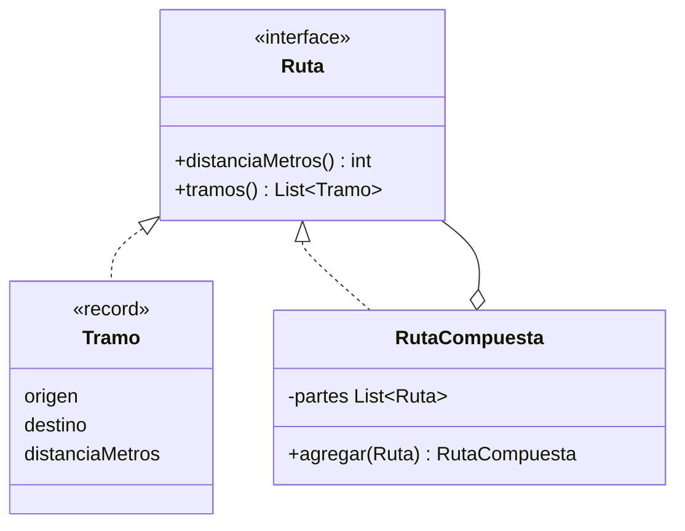
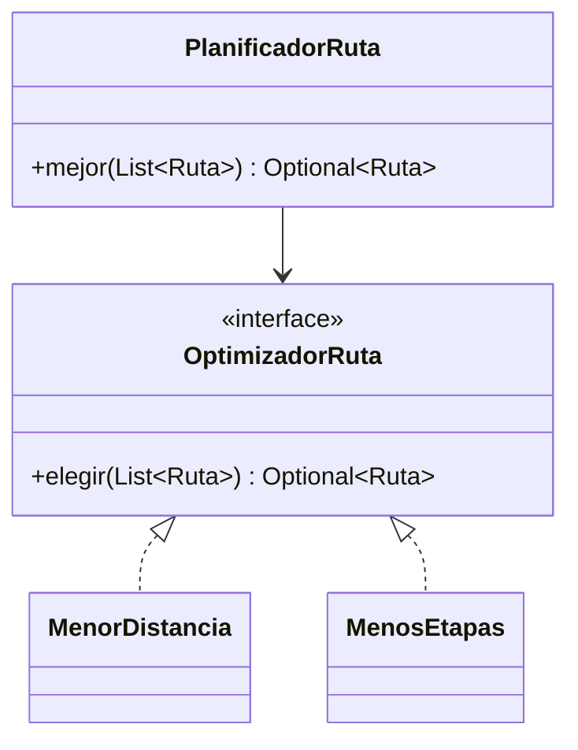
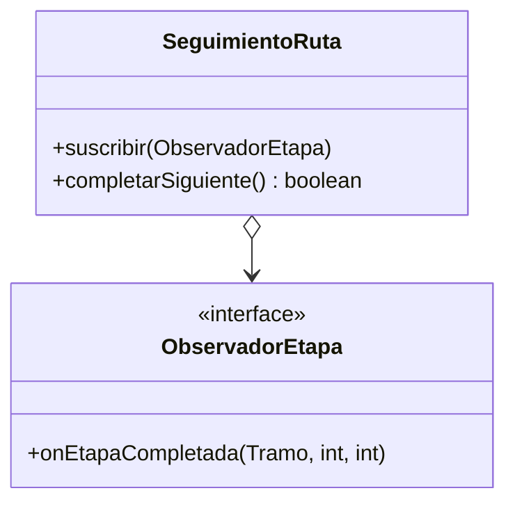
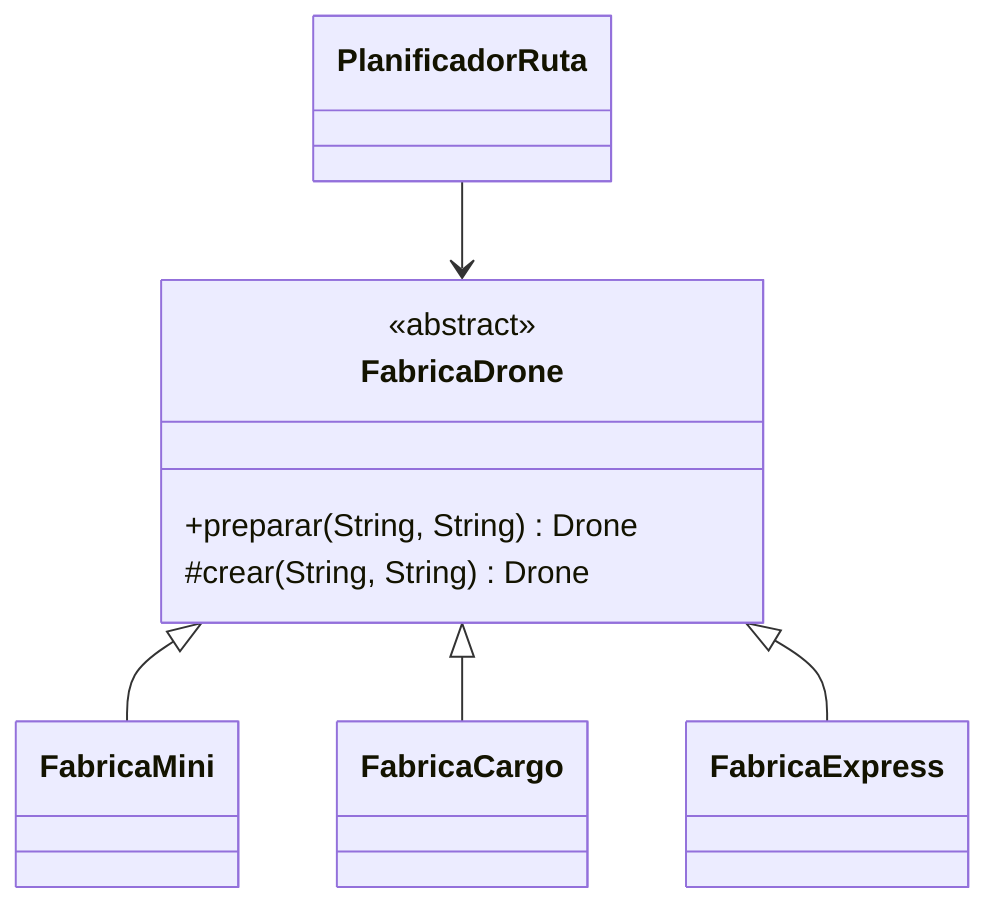

# Infernape 03 - Patrones de las rutas multi-etapa

Los cuatro patrones viven en `com.chimchar.skycampus.v3.dominio.ruta` y `v3.aplicacion.PlanificadorRuta`. Se prueban en `RutasTest`.

## Composite: rutas simples y compuestas

`Tramo` es la ruta simple y `RutaCompuesta` agrupa otras rutas, incluso otras compuestas. El cliente pide `distanciaMetros()` o `tramos()` sin saber con cuál trata.

**Por qué Composite y no otro.** Una ruta inter-sede es un árbol: tramos dentro de rutas dentro de rutas. Un Decorator agregaría comportamiento a una ruta, pero aquí se necesita agrupar, y un arreglo plano de tramos obligaría a cada cliente a recorrerlo y sumar por su cuenta.

## Strategy: algoritmos de optimización de ruta

`PlanificadorRuta` recibe el optimizador por constructor. Para una política nueva (por ejemplo, evitar zonas de viento) se agrega una clase y no se toca el planificador.

**Por qué Strategy y no otro.** El algoritmo cambia según la sede y el momento, y se decide al construir el planificador. Un `if` por criterio rompería el principio abierto/cerrado. Template Method obligaría a heredar del planificador para cambiar un solo paso.

## Observer: alerta de cada etapa

Cada vez que se completa un tramo, `SeguimientoRuta` avisa a todos los suscritos con el tramo, su número y el total. El panel, el log o el solicitante pueden suscribirse sin que el seguimiento los conozca.

**Por qué Observer y no otro.** Quien avisa no debe saber quién escucha ni cuántos son. Con Mediator habría un objeto central que conoce a todos los participantes y se vuelve un punto de acoplamiento. Es el mismo patrón que ya usa `GestorFlota` en v2.

## Factory Method: el drone correcto para cada etapa

`PlanificadorRuta.droneParaEtapa` elige el tipo según el peso (más de 500 g, CARGO) y la distancia del tramo (más de 3 km, EXPRESS; si no, MINI) y delega en la fábrica de ese tipo. Cada subclase decide capacidad y batería inicial del drone que crea.

**Por qué Factory Method y no otro.** El tipo concreto se conoce en tiempo de ejecución y cada tipo tiene reglas de creación propias. Abstract Factory serviría para familias de objetos relacionados y aquí se crea un solo producto. Un `switch` dentro del planificador mezclaría la selección con la construcción.

## Resumen

| Patrón | Clases | Problema que resuelve |
|---|---|---|
| Composite | `Ruta`, `Tramo`, `RutaCompuesta` | Tratar igual una ruta simple y una compuesta |
| Strategy | `OptimizadorRuta`, `MenorDistancia`, `MenosEtapas` | Cambiar el criterio de optimización |
| Observer | `ObservadorEtapa`, `SeguimientoRuta` | Avisar cada etapa completada |
| Factory Method | `FabricaDrone` y tres fábricas | Crear el drone adecuado por etapa |
