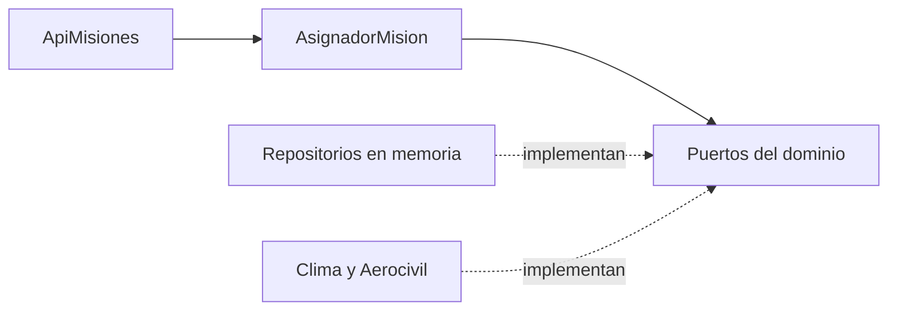

# Infernape 04 - AsignadorMision de Enterprise en 3 capas

## Capas

| Capa | Paquete | Contenido | Depende de |
|---|---|---|---|
| Dominio | `v3.dominio` | records `Drone`, `Mision`, `ResultadoAsignacion`, enum `MotivoRechazo` y los puertos `ServicioClima`, `ServicioAerocivil`, `RegistroSedes`, `RepositorioDrones`, `RepositorioMisiones`, `SeleccionDrone` | solo `java.*` y el propio proyecto |
| Aplicación | `v3.aplicacion` | `AsignadorMision`, `PlanificadorRuta`, `AnalisisRed`, `MonitorFlota`, `GestorZonas` | dominio |
| Infraestructura | `v3.infraestructura` | `ApiMisiones` (adaptador de entrada), repositorios en memoria | dominio y aplicación |

## Cómo se cumple SOLID

| Principio | En el código |
|---|---|
| S | `AsignadorMision` solo decide la asignación. Las rutas, las métricas y la flota están en otras clases. |
| O | Un criterio nuevo de selección es una clase que implementa `SeleccionDrone`. No se modifica el asignador. |
| L | Cualquier `ServicioClima` (un stub en una expresión lambda, un mock o el servicio real) se puede usar sin que el asignador lo note. |
| I | Los puertos son pequeños: `ServicioClima` tiene un método y `RegistroSedes` tiene uno. |
| D | `AsignadorMision` recibe interfaces por constructor y nunca instancia una implementación concreta. |

## Lo que demuestran las pruebas

- `AsignadorMisionTest` prueba la capa de aplicación solo con Mockito: ninguna llamada HTTP real ni base de datos. Cubre la asignación y los cinco rechazos.
- `ArquitecturaTest` lee los fuentes del dominio y falla si importan algo que no sea `java.*` o `com.chimchar.*`, o si el dominio depende de aplicación o infraestructura, o la aplicación de infraestructura.
- El dominio no tiene anotaciones de Spring ni librerías externas.

Sobre el endpoint REST: el proyecto todavía no incluye Spring (las dependencias de Maven Central no se podían descargar en el entorno de trabajo), así que `ApiMisiones` es el adaptador que recibe una `SolicitudMision` y devuelve una `RespuestaMision` con código 201, 409 o 422. Poner Spring encima solo implica anotar ese adaptador, sin tocar dominio ni aplicación.
