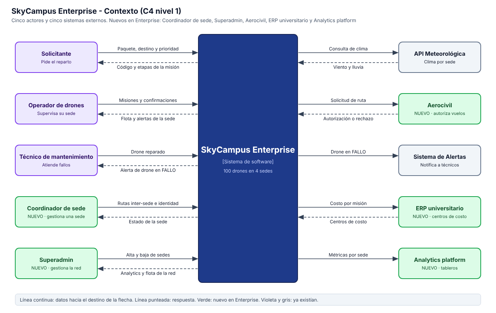
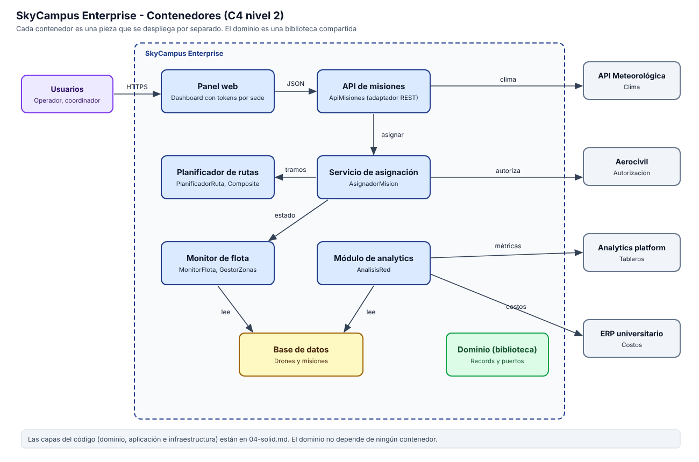

# Infernape 05 - Diagramas de contexto y contenedores

## Nivel 1: contexto de SkyCampus Enterprise

## Nivel 2: contenedores

Los contenedores se corresponden con el código: el panel web consume `ApiMisiones`, que llama a `AsignadorMision`. Este usa `PlanificadorRuta`, `MonitorFlota` y `GestorZonas`, y los puertos del dominio (clima, Aerocivil y repositorios). `AnalisisRed` lee los repositorios y envía las métricas a la plataforma de analytics.

## Comparación de los 3 contextos

| | MVP (Chimchar) | v2 (Monferno) | Enterprise (Infernape) |
|---|---|---|---|
| Actores | Solicitante, Operador, Admin | + Técnico de mantenimiento | + Coordinador de sede, Superadmin |
| Sistemas externos | ninguno | API Meteorológica, Control Aéreo ECI, Sistema de Alertas | + Aerocivil, ERP universitario, Analytics platform |
| Flota | 5 drones | 20 drones | 100 drones en 4 sedes |
| Sedes | 1 | 1 | 4 |

**Qué creció.** Los actores (de 3 a 5), los sistemas externos (de 0 a 5 en total contando los que aparecieron en v2) y la escala de la flota. El sistema pasó de una consola local a una red con integraciones de red y dos roles de gestión.

**Qué se mantuvo.** El sistema sigue siendo una sola caja en el centro, el operador, el solicitante y el técnico conservan su papel, y el flujo central (pedir, asignar con validaciones, entregar) es el mismo del MVP. El dominio de drones y misiones viene de Chimchar.

**Cómo evolucionó la complejidad sin perder coherencia.** Cada nivel agregó una sola razón para crecer: v2 agregó visibilidad y seguridad operativa (clima y alertas), Enterprise agrega escala y regulación (sedes y Aerocivil). Las dependencias nuevas entraron como puertos del dominio, no como cambios en las reglas existentes. Por eso la regla de batería mínima de 30 % es la misma en los tres niveles.
