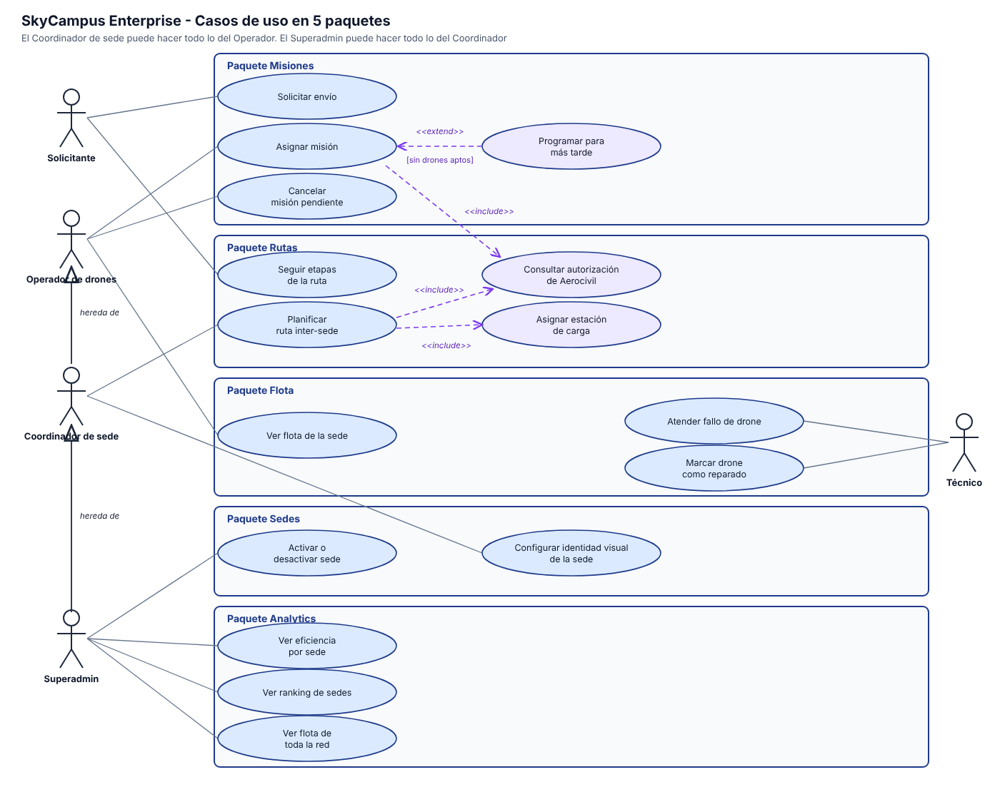

# Infernape 10 - Casos de uso de SkyCampus Enterprise

## Actores y herencia

| Actor | Hace |
|---|---|
| Solicitante | Solicitar envío, Seguir etapas de la ruta |
| Operador de drones | Asignar misión, Cancelar misión pendiente, Ver flota de la sede |
| Coordinador de sede | Todo lo del Operador, más Planificar ruta inter-sede y Configurar identidad visual de la sede |
| Superadmin | Todo lo del Coordinador, más Activar o desactivar sede, Ver eficiencia por sede, Ver ranking de sedes y Ver flota de toda la red |
| Técnico | Atender fallo de drone, Marcar drone como reparado |

El Coordinador extiende al Operador y el Superadmin extiende al Coordinador, con flechas de generalización. Por eso los casos del Operador no se repiten en los otros dos.

## Los 5 paquetes

| Paquete | Casos de uso |
|---|---|
| Misiones | CU-E01 Solicitar envío, CU-E02 Asignar misión, CU-E03 Cancelar misión pendiente, CU-E04 Programar para más tarde |
| Rutas | CU-E05 Consultar autorización de Aerocivil, CU-E06 Planificar ruta inter-sede, CU-E07 Asignar estación de carga, CU-E08 Seguir etapas de la ruta |
| Flota | CU-E09 Ver flota de la sede, CU-E10 Atender fallo de drone, CU-E11 Marcar drone como reparado |
| Sedes | CU-E12 Activar o desactivar sede, CU-E13 Configurar identidad visual de la sede |
| Analytics | CU-E14 Ver eficiencia por sede, CU-E15 Ver ranking de sedes, CU-E16 Ver flota de toda la red |

## include

| Caso base | Incluye | Por qué |
|---|---|---|
| Asignar misión | Consultar autorización de Aerocivil | sin autorización vigente no se puede volar, siempre |
| Planificar ruta inter-sede | Consultar autorización de Aerocivil | la ruta solo es válida si el corredor está autorizado |
| Planificar ruta inter-sede | Asignar estación de carga | toda ruta con paradas necesita carga en cada una |

## extend

| Caso base | Extensión | Condición |
|---|---|---|
| Asignar misión | Programar para más tarde | solo cuando no hay drones aptos en la sede |

## Cómo leerlo sin explicación

Cada recuadro es un tema (misiones, rutas, flota, sedes, analytics) y cada óvalo es algo que una persona puede hacer. Las líneas conectan a cada persona con lo que hace, y la flecha de herencia indica que quien está debajo puede hacer también lo de quien está arriba.
