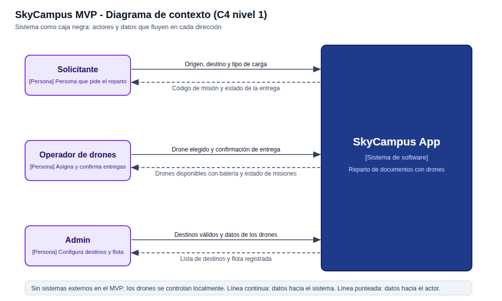
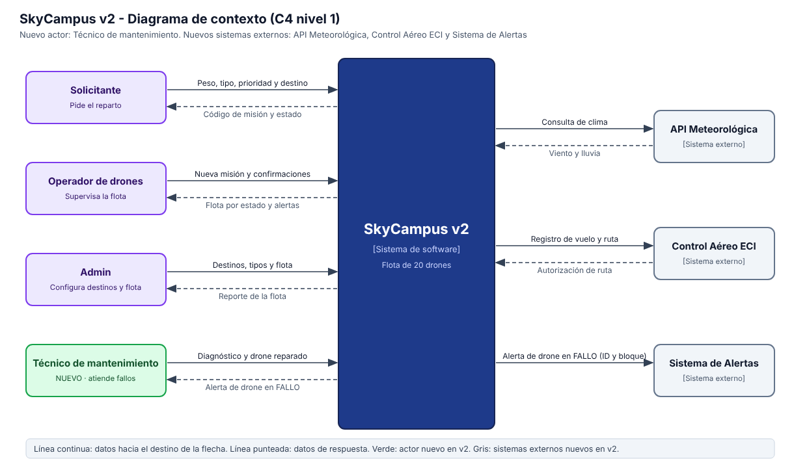

# Monferno 05 - Diagrama de contexto: MVP vs v2

## MVP (Chimchar)

## v2 (Monferno)

## Comparación

| | MVP | v2 |
|---|---|---|
| Actores | Solicitante, Operador, Admin | los mismos, más el Técnico de mantenimiento |
| Sistemas externos | ninguno | API Meteorológica, Control Aéreo ECI y Sistema de Alertas |
| Flota | 5 drones del mismo modelo | 20 drones de 3 tipos |

### Flujos de los sistemas externos

| Sistema | Dirección | Datos |
|---|---|---|
| API Meteorológica | SkyCampus → API | consulta de clima |
| API Meteorológica | API → SkyCampus | viento y lluvia |
| Control Aéreo ECI | SkyCampus → Control | registro de vuelo y ruta |
| Control Aéreo ECI | Control → SkyCampus | autorización de ruta |
| Sistema de Alertas | SkyCampus → Alertas | alerta de drone en FALLO con ID y bloque |

### Qué creció

El número de actores (de 3 a 4) y, sobre todo, la frontera del sistema: pasó de no tener integraciones a depender de tres sistemas externos. Cada actor también recibe más información, por ejemplo el operador ahora ve la flota por estado y las alertas.

### Qué se mantuvo

El sistema sigue siendo una caja negra con los mismos tres actores originales, las mismas interacciones básicas (el solicitante pide el reparto, el operador supervisa y confirma, el admin configura) y el mismo propósito: repartir documentos entre bloques de la ECI.
