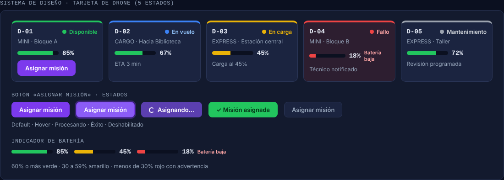

# Monferno 08 - Sistema de diseño y leyes UX

Los valores (paleta, tipografías y colores de estado) vienen de `docs/08-identidad-ux.md`. En v2 se agrega el gris `#9CA3AF` para el estado Mantenimiento.

## Tarjeta de drone

| Estado | Color | Contenido adicional |
|---|---|---|
| Disponible | Verde `#22C55E` | botón «Asignar misión» |
| En vuelo | Azul `#3B82F6` | destino y ETA |
| En carga | Amarillo `#EAB308` | porcentaje de carga |
| Fallo | Rojo `#EF4444`, fondo rojo tenue | aviso de técnico notificado |
| Mantenimiento | Gris `#9CA3AF` | motivo o fecha de revisión |

Todos los estados llevan punto de color y texto, así que el color nunca es la única señal.

## Botón «Asignar misión»

Default, hover, procesando (con spinner), éxito y deshabilitado.

## Indicador de batería

60% o más en verde, entre 30% y 59% en amarillo, y menos de 30% en rojo con la advertencia «Batería baja».

## Flujo de asignación automática

| Pantalla | Archivo |
|---|---|
| 1. Panel de flota | `mock/01-panel-flota.png` |
| 2. Formulario de misión | `mock/02-formulario-mision.png` |
| 3. Confirmación | `mock/03-confirmacion.png` |

## Ley de Fitts

- «Nueva misión» y «Cancelar misión en vuelo» son los botones más grandes de la pantalla (48 px de alto o más) y están arriba a la izquierda, siempre visibles.
- La cancelación de emergencia no está en un menú: es un botón rojo de primer nivel.
- En la confirmación, «Confirmar misión» y «Cancelar» son botones grandes y están juntos.

## Ley de Hick

- Los 20 drones no se muestran en una lista plana: se agrupan en 5 columnas por estado, con el conteo en el encabezado de cada grupo.
- El resumen del encabezado cuenta los drones por estado, así el operador decide sin recorrer todos.
- En el formulario solo se listan los 6 drones aptos con más batería, no la flota entera.

## Número de Miller

El `PanelOperador` no acumula más de 7 notificaciones sin confirmar (probado en `ObservadoresTest.panelMaximoSiete`), y el pie del panel muestra el contador «Alertas sin confirmar: 1 de 7».
