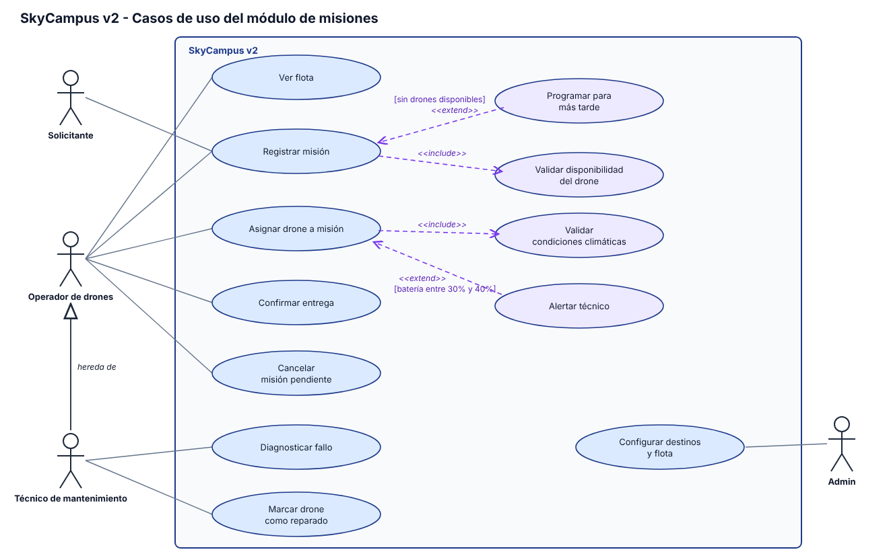

# Monferno 10 - Casos de uso del módulo de misiones v2

## Actores

| Actor | Casos de uso |
|---|---|
| Solicitante | Registrar misión |
| Operador de drones | Ver flota, Registrar misión, Asignar drone a misión, Confirmar entrega, Cancelar misión pendiente |
| Técnico de mantenimiento | Hereda del Operador (ver flota y todo lo del operador), más Diagnosticar fallo y Marcar drone como reparado |
| Admin | Configurar destinos y flota |

La herencia está dibujada con una flecha de generalización del Técnico al Operador, por eso los casos de uso del operador no se repiten para el técnico.

## include

| Caso base | Incluye | Por qué |
|---|---|---|
| Asignar drone a misión | Validar condiciones climáticas | no se puede volar sin verificar el clima, siempre |
| Registrar misión | Validar disponibilidad del drone | sin esa validación no hay misión |

## extend

| Caso base | Extensión | Condición |
|---|---|---|
| Asignar drone a misión | Alertar técnico | solo cuando el drone seleccionado tiene batería entre 30% y 40% |
| Registrar misión | Programar para más tarde | solo cuando no hay drones disponibles |
